# 5. 正交分頻多工 (OFDM)：保護頻帶、循環前綴與快速傅立葉轉換

> **核心觀念**：OFDM 不是一種新的單載波調變方式，而是一種「**把一條寬頻通道切成很多條窄頻通道**」的多載波傳輸策略。它在頻域用「正交」取代相鄰子載波間的保護頻帶，在時域用「循環前綴 (CP)」擋下多路徑干擾，最後靠 IDFT/FFT 一次處理數千個子載波——同時解決了干擾與硬體複雜度兩個難題。
>
> 其中 CP 的真正數學作用，是把「通道造成的線性卷積」轉換成「**循環卷積**」，讓每個子載波在頻域上只被乘上一個複數 $H[k]$，這就是**單抽頭等化**能成立的嚴格原因。全篇的公式統一使用 $W_N \triangleq e^{-j\frac{2\pi}{N}}$ 這個記號（見下方「符號約定」）。

---

## 本章地圖

| 段落 | 要回答的問題 |
|---|---|
| 雙重邊界 | 為什麼傳輸訊號一定要在頻域與時域設下防護？ |
| 離散傅立葉轉換 (DFT) | 面對 $N$ 個取樣點，怎麼知道裡面藏了哪些頻率？ |
| DFT / IDFT 矩陣形式 | $N=4$ 時，這個轉換長成什麼樣的矩陣？ |
| 正交性 (Orthogonality) | 為什麼不同頻率疊在一起傳，卻不會互相干擾？ |
| OFDM 頻譜 | 正交重疊在頻域上到底長什麼樣子？ |
| 循環前綴 (CP) | 保護時間為什麼不能留空白，而要「複製尾巴」？ |
| 循環卷積 (Circular Convolution) | CP 到底為什麼能讓等化變成「一個除法」？ |
| 快速傅立葉轉換 (FFT) | DFT 那麼慢，真實系統怎麼跑得動？ |
| 2-Point FFT 蝶形 | 分治法的每一步，實際電路長什麼樣子？ |
| OFDM 發送 / 接收流程 | 位元是怎麼變成空中的電磁波，又怎麼拆回來？ |
| OFDM 設計版本 | 4 個子通道可以怎麼安排？ |

---

## 訊號傳輸的雙重邊界：頻域與時域的防護機制

在任何實際通訊媒介中傳輸訊號，都無法脫離「時間（Time）」與「頻率（Frequency）」兩個基本維度的物理制約。為了確保訊號在傳輸過程中不被干擾，通訊系統必須在頻域與時域各自設立邊界防護：

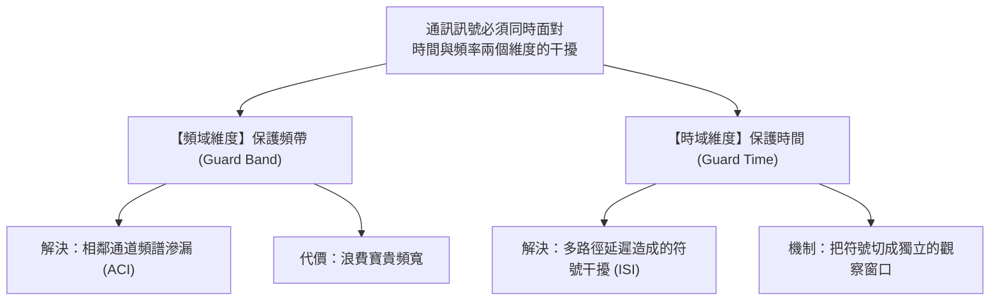

### 頻域防護：保護頻帶 (Guard Band)

在傳統分頻多工 (FDM) 架構下，多個通訊通道並行傳輸。由於實際濾波器無法做到完美的垂直截止邊緣，訊號的能量必然會向兩側頻率擴散（旁波瓣 Sidelobes）。

若相鄰通道緊密貼合，這些擴散的能量就會侵入鄰近通道，引發**相鄰通道干擾 (Adjacent Channel Interference, ACI)**。傳統的解決方式是在相鄰頻道之間刻意保留一段無訊號的頻率空白——**保護頻帶 (Guard Band)**：

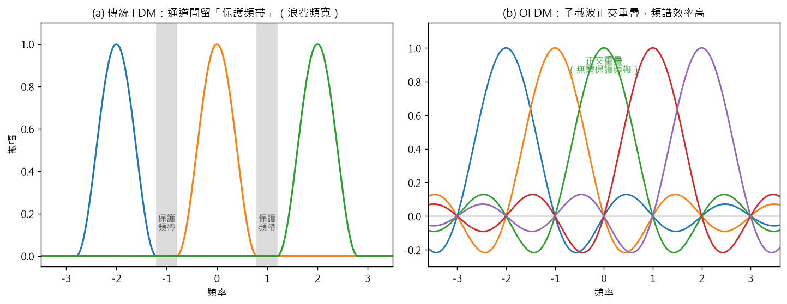

上圖對照兩種做法：**(a) 傳統 FDM** 每個通道的頻譜（旁波瓣）會向兩側滲漏，相鄰通道之間必須空出一段不用的「保護頻帶」；**(b) OFDM** 子載波雖然緊密重疊，但因為正交，彼此不會互相干擾，因此不需要保護頻帶。

> **頻域代價**：保護頻帶是完全不承載任何有效資料的頻譜留白。隨著並行通道數量增加，保護頻帶佔用的頻寬比例大幅攀升，造成極大的頻譜資源浪費。

---

### 時域防護：保護時間 (Guard Time)

與頻域相對，在時間軸上，無線電波會經由地面、建物等多重路徑（直射波、反射波、散射波）到達接收端，即**多路徑傳播 (Multipath Propagation)**。

多條路徑的長度不同，導致訊號抵達的時間產生先後落差，最早抵達與最晚抵達的分量之間的時間差稱為**延遲擴展 (Delay Spread, $\tau_{\max}$)**。

如果時域上的資料符號前後緊密相連，前一個符號的多路徑反射波殘影，就會疊加在下一個符號的前端，造成嚴重的**符號間干擾 (Inter-Symbol Interference, ISI)**：

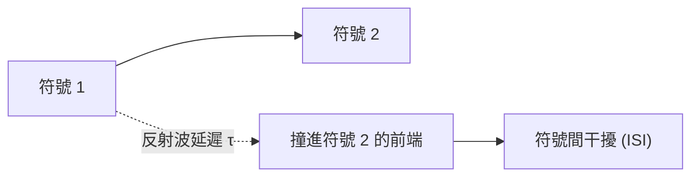

為了解決這個問題，系統必須在時域上以獨立區塊進行傳輸，並在相鄰符號之間插入一段空白間隔——**保護時間 (Guard Time, $T_g$)**：

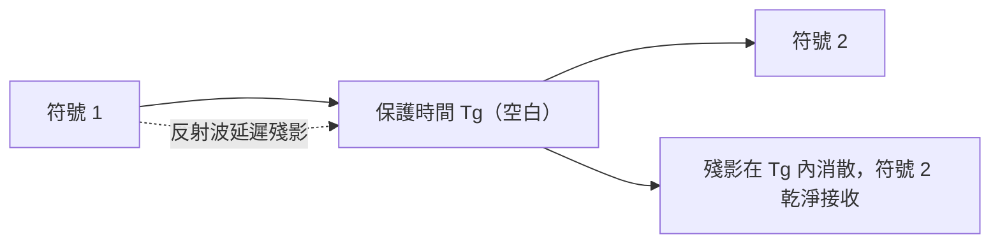

只要確保保護時間大於通道的最大延遲擴展（$T_g \ge \tau_{\max}$），前一符號的所有反射波能量都會在保護時間內消散完畢，後續符號便能在乾淨的區間被接收，**徹底消除符號間干擾 (ISI)**。

---

## 串聯樞紐：從「時域分塊取樣」通往「離散傅立葉轉換」

請仔細觀察上述的保護時間機制——它為我們帶來了一個非常關鍵的轉變：

為了躲避多路徑干擾，我們**不能再把訊號當作一條連綿不絕、無限長的連續波形**來處理。我們必須在時間軸上把它切成一個個長度為 $T$ 的獨立「時間區塊 (Time Block)」，每個區塊前後都有保護時間隔開：

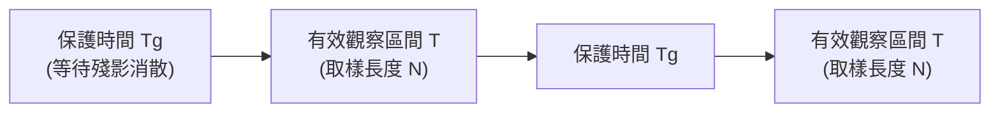

而在現代接收端的數位晶片裡，電腦根本不懂連續的電壓波形，它只能在長度 $T$ 的有效觀察窗口裡，每隔一段微小時間「拍照取樣」一次，採集到有限個（例如 $N$ 個）數位數值：

$$x[0], x[1], x[2], \dots, x[N-1]$$

這時候，一個極其根本的問題擺在眼前：

> **面對手中這一串只有 $N$ 個點的離散數字，我們該如何知道它裡面藏了哪些頻率成分？**

這正是我們需要**離散傅立葉轉換 (Discrete Fourier Transform, DFT)** 的起點。

---

## 離散傅立葉轉換 (DFT) 的直覺與概念

在進入任何複雜數學式之前，我們先建立物理直覺。

### 1. 人類的耳朵是怎麼聽音樂的？

想像你在鋼琴上同時按下 `Do`、`Mi`、`Sol` 三個鍵組成和弦：
* 如果用示波器看時域波形，你會看到一條高低起伏、形狀怪異複雜的曲線。
* 但你的耳朵和大腦卻能輕易分辨：「這裡面有 `Do`、有 `Mi`、還有 `Sol`！」

**傅立葉轉換在做的事，本質上就是幫波形「抓出藏在裡面的音符」**——把一段看似複雜混亂的時間訊號，拆解成各個不同頻率的單純波形，並告訴你每一個頻率的分量有多大（振幅）、何時開始震動（相位）。

---

### 2. 電腦要怎麼測量「某個頻率在不在」？—— 音叉與共振的直覺

想像你想知道一個混雜的聲音裡有沒有 440 Hz（標準音 A）的聲音，最直覺的做法是什麼？

拿一把 440 Hz 的標準音叉靠近它！
* 如果聲音裡**有** 440 Hz，音叉就會產生強烈**共振（Resonance）**。
* 如果聲音裡**完全沒有** 440 Hz，音叉就幾乎動也不動。

在電腦的數位運算裡，我們沒有實體音叉，但可以用純數學做出一模一樣的「共振檢驗」：**相乘並加總（內積 / 投影）**。

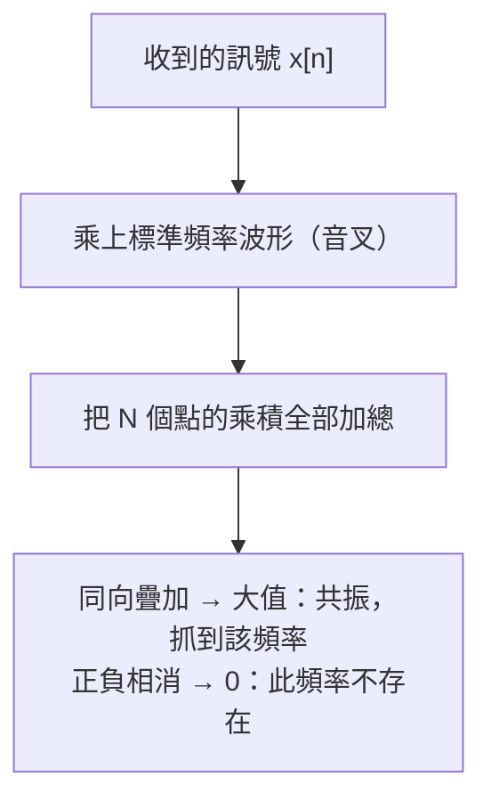

* **如果訊號裡正好有這個頻率**：訊號的波峰正好對上音叉的波峰、波谷對上波谷，相乘後「正正得正、負負也得正」，每個取樣點都貢獻正值，加總起來就會是一個**非常大的數值** $\implies$ **共振成功！抓到這個頻率了！**
* **如果訊號裡沒有這個頻率（或頻率不匹配）**：兩者的起伏節奏不同步，有時候相乘是正、有時候相乘是負，在長度 $N$ 的區間內正負互相抵消，加總結果**精確為 0** $\implies$ **沒有共振，代表這個頻率不存在。**

---

### 3. 理解正轉換 (Forward DFT) 的數學式

有了「音叉共振測試」的直覺，我們再來看離散傅立葉轉換的定義式，就會發現它一點都不神秘。先統一一個記號：

**符號約定（全篇通用）**：$W_N \triangleq e^{-j\frac{2\pi}{N}}$，於是 $W_N^{kn} = e^{-j\frac{2\pi}{N}kn}$。特別地 $W_4 = e^{-j\frac{\pi}{2}} = -j$。

因此正轉換可寫成：

$$X[k] = \sum_{n=0}^{N-1} x[n] \cdot W_N^{kn}, \quad k = 0, 1, \dots, N-1$$

（與原始的 $X[k] = \sum_{n=0}^{N-1} x[n] \cdot e^{-j\frac{2\pi}{N}kn}$ 完全等價。）

讓我們像拆解積木一樣拆開每個符號：

| 符號 | 角色 | 直覺意義 |
|:---:|:---:|:---|
| $x[n]$ | **原始時域取樣** | 接收端在時間區塊內採集到的第 $n$ 個數值 ($n = 0 \dots N-1$)。 |
| $W_N^{kn}$ | **第 $k$ 號虛擬音叉** | 電腦自己產生的標準測試波形（$=e^{-j\frac{2\pi}{N}kn}$，代表旋轉速度為 $k$ 的正弦與餘弦波）。 |
| $x[n] \cdot W_N^{kn}$ | **逐點比對** | 訊號與測試音叉在每個取樣點的強度相乘。 |
| $\sum_{n=0}^{N-1}$ | **共振加總** | 把這 $N$ 個點的乘積全部加起來，看是否有共振放大。 |
| $X[k]$ | **頻率 $k$ 的檢測結果** | 一個複數，**大小**代表頻率強度，**角度**代表起始相位。 |

這就是正離散傅立葉轉換：拿 $N$ 支不同頻率的「音叉」（$k = 0, 1, \dots, N-1$），一支一支去測試我們手上的時域訊號 $x[n]$，最後得到 $N$ 個頻率的成分強度 $X[k]$。

---

### 4. 理解反轉換 (Inverse DFT, IDFT) 的數學式

那如果反過來呢？假設我們已經知道了各個音符各自有多大聲（頻域數值 $X[k]$），我們想把這首「樂曲」重新在時域上播放出來，該怎麼做？

答案就是把這 $N$ 個標準波形乘上各自的權重 $X[k]$，通通疊加在一起。用 $W_N$ 記號寫起來就是：

$$x[n] = \frac{1}{N} \sum_{k=0}^{N-1} X[k] \cdot W_N^{-kn}, \quad n = 0, 1, \dots, N-1$$

（等價於 $x[n] = \frac{1}{N}\sum_{k=0}^{N-1} X[k]\cdot e^{j\frac{2\pi}{N}kn}$；注意指數的負號與 DFT 相反。）

這就是**反離散傅立葉轉換 (IDFT)**——從頻域的音符成分，重新組裝合成出原本的時域波形（前方除以 $N$ 只是把能量尺度縮放還原）。

### 5. DFT 的矩陣形式（以 $N = 4$ 為例）

DFT 其實就是一個「矩陣乘法」。把 $N$ 個取樣點排成向量 $\mathbf{x} = [x[0], x[1], \dots, x[N-1]]^{\mathsf T}$，輸出向量 $\mathbf{X} = [X[0], X[1], \dots, X[N-1]]^{\mathsf T}$，則

$$\mathbf{X} = F_N\,\mathbf{x}$$

其中 $F_N$ 是 $N\times N$ 的 DFT 矩陣，第 $(k,n)$ 個元素就是 $W_N^{kn}$。以 $N=4$（$W_4 = -j$）為例：

$$F_4 = \begin{bmatrix}
1 & 1 & 1 & 1 \\
1 & W_4^{1} & W_4^{2} & W_4^{3} \\
1 & W_4^{2} & W_4^{4} & W_4^{6} \\
1 & W_4^{3} & W_4^{6} & W_4^{9}
\end{bmatrix}
= \begin{bmatrix}
1 & 1 & 1 & 1 \\
1 & -j & -1 & j \\
1 & -1 & 1 & -1 \\
1 & j & -1 & -j
\end{bmatrix}$$

每一「列」就是一支音叉：第 $k$ 列對應頻率 $k$ 的檢測。矩陣乘法 $X[k] = \sum_n (F_4)_{kn}\,x[n]$ 正好就是 DFT 定義式。

### 6. IDFT 的矩陣形式

IDFT 就是 DFT 矩陣的反矩陣；而 DFT 矩陣剛好是「么正矩陣（差一個 $1/N$ 係數）」，所以反矩陣只要「取共軛轉置、再乘 $\frac{1}{N}$」：

$$\mathbf{x} = \frac{1}{N} F_N^{\mathsf H}\,\mathbf{X}$$

以 $N=4$ 為例：

$$F_4^{-1} = \frac{1}{4}\begin{bmatrix}
1 & 1 & 1 & 1 \\
1 & j & -1 & -j \\
1 & -1 & 1 & -1 \\
1 & -j & -1 & j
\end{bmatrix}$$

> **一眼看懂正交性**：$F_4$ 的任兩列（或任兩行）內積都是 0，代表不同頻率的音叉互相垂直——這就是下一節「正交性」的矩陣版本。

---

## 核心基石：為什麼頻率之間不會打架？—— 正交性 (Orthogonality)

這時候同學們心中一定會產生一個關鍵疑問：

> 「老師，當我用第 $k_1$ 號音叉去測訊號時，如果訊號裡同時有第 $k_2$ 號頻率，難道第 $k_2$ 號頻率不會跑來干擾，讓我誤以為第 $k_1$ 號頻率也很強嗎？」

答案是：**只要頻率挑得正確，就絕對不會干擾！**

這就是整個傅立葉分析中最美妙、最重要的核心性質——**正交性 (Orthogonality)**。

### 1. 幾何直覺：二維空間中的直角座標

想想二維平面上的 $X$ 軸與 $Y$ 軸：
* 它們彼此夾角是 90 度（互相垂直、正交）。
* 一個純粹沿著 $X$ 軸移動的向量 $(5, 0)$，如果我們去測量它在 $Y$ 軸上的投影分量，答案永遠是 $0$。
* 無論 $X$ 軸方向的數值多大，它都完全不會「漏」到 $Y$ 軸去，兩者互不干涉。

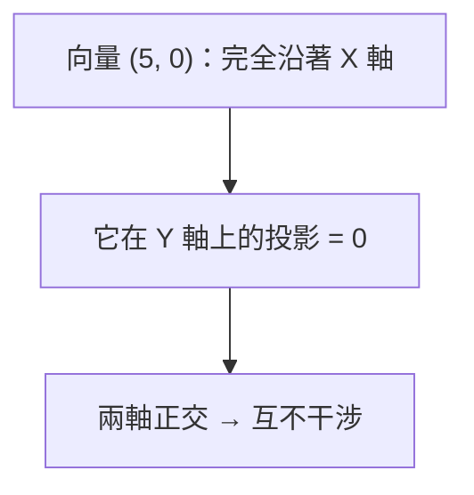

### 2. 離散諧波波形的正交驗證

在離散傅立葉轉換中，這 $N$ 個標準測試波形 $e^{j \frac{2\pi}{N} kn}$，就相當於高維度空間中一組**彼此互相垂直的座標軸**。

如果我們拿頻率為 $k_1$ 的波形，去和頻率為 $k_2$ 的波形做內積（相乘並在 $N$ 個取樣點上求和）：

$$\frac{1}{N} \sum_{n=0}^{N-1} W_N^{-k_1 n} \cdot W_N^{k_2 n} = \frac{1}{N} \sum_{n=0}^{N-1} W_N^{(k_2 - k_1)n}$$

這個式子的結果會呈現兩種截然不同的情況：

#### 情況 A：當 $k_1 = k_2$（測試同一個頻率）
指數項變成 $e^{0} = 1$，所有取樣點全部同向疊加：
$$\frac{1}{N} \sum_{n=0}^{N-1} 1 = \frac{1}{N} \times N = 1$$
能量完全保留，測出真實數值。

#### 情況 B：當 $k_1 \ne k_2$（測試不同頻率）
因為頻率差 $(k_1 - k_2)$ 是非零整數，代表這個旋轉向量在長度為 $N$ 的取樣區間內，剛好在複數平面上**均勻旋轉了整數整整好幾圈**：

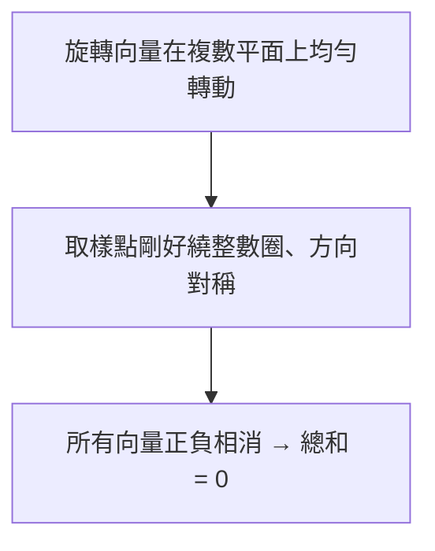
因為每個方向的箭頭都有相反方向的箭頭與之抵消，所有點加總起來的結果**精確為 0**：

$$\frac{1}{N} \sum_{n=0}^{N-1} W_N^{(k_2 - k_1)n} = 0 \quad (k_1 \ne k_2)$$

我們可以用一個簡潔的數學符號（Kronecker Delta $\delta$）總結這個美妙的結果：

$$\frac{1}{N} \sum_{n=0}^{N-1} W_N^{-k_1 n} \cdot W_N^{k_2 n} = \delta[k_1 - k_2] = \begin{cases} 1, & k_1 = k_2 \\ 0, & k_1 \ne k_2 \end{cases}$$

---

### 3. 正交性的教學總結

正交性告訴我們一件極度關鍵的物理事實：

在一個長度為 $N$ 的取樣窗口內，只要我們挑選的各個頻率滿足以 $\frac{1}{T}$（即整數倍 index $k$）為間隔，那麼：

1. **每個頻率成分就像走在各自獨立的專屬通道上**。
2. 即使它們在時域上全部混在一起傳輸，當我們在接收端拿特定頻率的基底去投影（做 DFT 運算）時，**其他所有頻率的分量都會因為正交性而精確抵消為 0**，絲毫不會產生串擾。

這正是為什麼我們能夠在同一個時域區塊內，毫無失真地把各個離散頻率成分乾淨俐落地分離開來的根本數學保證。

### 4. 從矩陣看正交性（補充）

回顧上一節的 DFT 矩陣 $F_4$：它的每一「列」就是一支音叉。正交性在矩陣上的意思是——**任兩列（或任兩行）的內積都是 0**：

$$F_4 F_4^{\mathsf H} = 4\,I_4 \quad\Longrightarrow\quad \frac{1}{4}F_4 F_4^{\mathsf H} = I_4$$

只有「同一列與自己」內積會得到 $N=4$（乘上 $1/N$ 後變成 1），不同列之間都精確為 0。這就是為什麼 IDFT 只要「共軛轉置再除以 $N$」就能還原——矩陣正交性保證了 $F_4^{-1} = \frac{1}{4}F_4^{\mathsf H}$。

### 5. 正交性的頻域長相：OFDM 頻譜（補充）

把正交性畫成頻譜，會得到下圖：每個子載波的頻譜是一個 $\operatorname{sinc}$ 函數，**它的波峰剛好對準其他所有子載波的零點**。所以即使這些子載波在頻域上大幅重疊，在每個子載波的中心頻率上，其他子載波的貢獻都精確為 0——這就是「正交重疊」的實體樣貌。

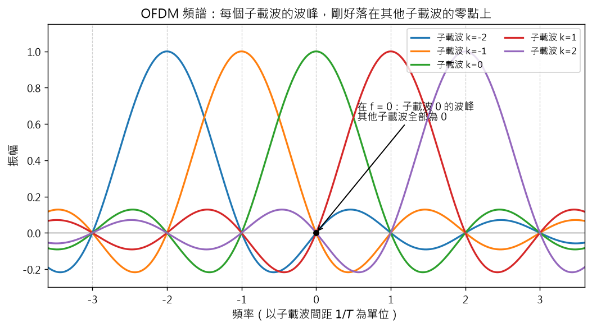

用式子表達：第 $k$ 個子載波（理想矩形脈衝）的頻譜為

$$S_k(f) = \operatorname{sinc}\!\left(f - \frac{k}{T}\right), \quad \text{且 } S_k\!\left(\frac{k'}{T}\right) = \delta[k-k']$$

換句話說，在第 $k'/T$ 這個頻率點上取樣時，只有 $k=k'$ 的子載波有值，其餘全為 0。這正是 OFDM 能在「零保護頻帶」下仍不互相干擾的原因。

---

## 循環前綴 (Cyclic Prefix, CP)：保護時間的進化版

前面我們用「一段空白」當作保護時間，聽起來很合理。但在 OFDM 裡，直接留空白會遇到一個致命問題。

### 為什麼「空白」保護時間不夠用？

回想 DFT 能乾淨分離頻率的條件：在長度 $T$ 的觀察窗口內，每個子載波都要「剛好轉完整數圈」。這是正交性的前提。

現在多路徑的延遲波闖了進來。如果保護時間是空白，雖然上一個符號的殘影已經被擋在窗外，但**當前符號自己的延遲複本會晚一步才進入 FFT 窗口**，而且尾巴被切掉了。窗口內收到的，是一個「頭尾接不起來」的殘缺波形：

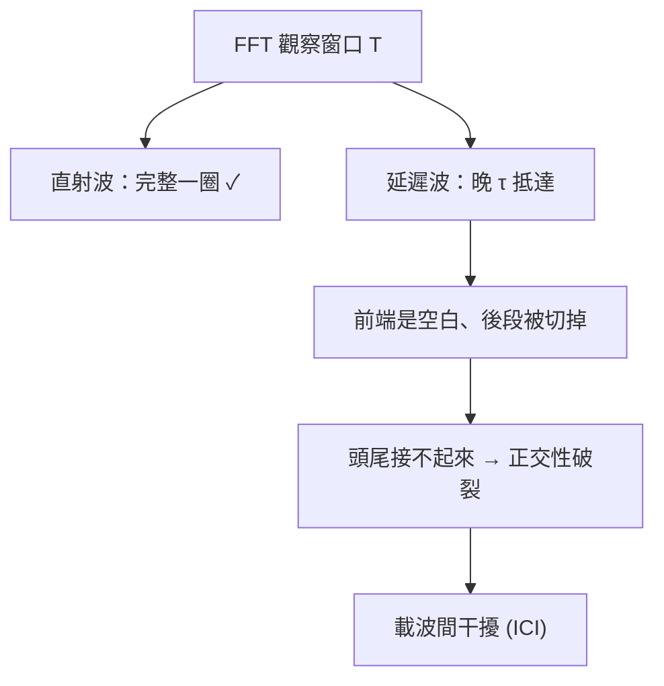

這裡的干擾不是符號與符號之間的 ISI，而是「子載波與子載波之間」的干擾，稱為**載波間干擾 (Inter-Carrier Interference, ICI)**。它比 ISI 更棘手，因為所有子載波都混在一起了。

### 解法：不要留白，把尾巴複製到前面

既然問題出在「窗口內的波形不完整」，那就**主動把符號的尾巴複製一份、貼到符號的前面**。這段複製出來的前置片段，就是**循環前綴 (Cyclic Prefix, CP)**。

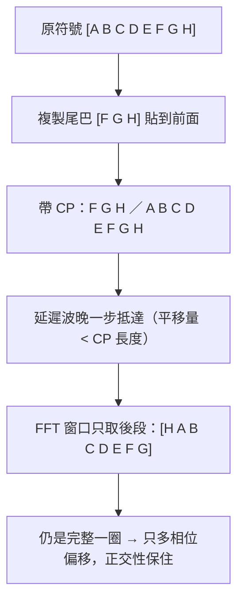

### 為什麼這樣就有效？

關鍵在於：**CP 讓「被延遲的波形」在窗口內仍然是完整的一圈**。

CP 是從符號尾巴複製來的，等於把「一個週期的結尾」實際送到空中。當延遲複本晚一步才進入窗口時，它缺少的前段剛好由 CP 補上；換句話說，延遲複本在窗口內看起來就只是「把整個符號循環平移」——而循環平移只會讓每個子載波多一個相位偏移，不會破壞整數圈的特性。

> 這也是為什麼接收端可以放心地把 CP 丟掉：它的任務只是「保護」窗口內的波形完整，本身不承載新資訊。

用一句話總結：

> **保護時間若留白，只能擋住 ISI；加上 CP，才能同時擋住 ISI 與 ICI。**

### CP 的代價與設計原則

| 項目 | 說明 |
|---|---|
| 長度條件 | $T_{cp} \ge \tau_{\max}$（要長於最大延遲擴展） |
| 代價 | 佔用時間，但**不佔用額外頻寬**（資料只是被複製，沒有多送新頻率） |
| 效率 | CP 越長，抗多路徑能力越強，但有效資料占比越低 |
| 實務取值 | 約有效符號長度的 $1/4 \sim 1/16$（例如 LTE 的 normal CP 約 $4.7\,\mu s$） |

> **為什麼 CP 比保護頻帶划算？**
> 保護頻帶是「頻率資源的永久浪費」，通道數越多、浪費越多；CP 只是把同一段資料複製一次，佔用的是時間，也不會讓相鄰通道互相干擾。OFDM 之所以能拿掉相鄰子載波之間的保護頻帶、讓它們緊密重疊，靠的就是**正交性 + CP** 這對組合。

---

## 循環卷積：CP 真正在做的事（LTI 系統觀點）

前面說 CP 是「讓窗口內的波形維持完整一圈」，這只是直覺。真正讓 OFDM 能「一個除法就完成等化」的，是下面這條**線性時不變系統 (LTI)** 的推理鏈。

### 1. 通道是一個 LTI 系統

無線通道（多路徑 + 衰減）可以看成一個**線性時不變系統 (Linear Time-Invariant, LTI)**，它有脈衝響應 $h[n]$（或 $h(t)$）。訊號經過通道，就是在時域上做**卷積**：

$$y[n] = x[n] * h[n] = \sum_{m} h[m]\, x[n-m]$$

多路徑的每一條路徑，就是 $h[n]$ 裡的一個延遲分量。這一步是「線性卷積」，結果長度會變成 $N + L - 1$。

### 2. 多路徑 = 符號自己撞自己：Intra-Symbol Interference

多路徑的延遲副本，除了會撞到下一個符號（ISI），**更會跟「同一個符號自己」的較晚部分重疊**。這種「符號內部的自我干擾」稱為**符號內干擾 (Intra-Symbol Interference)**。

如果不管它，接收端在窗口內看到的其實是「好幾個平移版本的自己疊在一起」，波形被扭曲，正交性也就保不住。

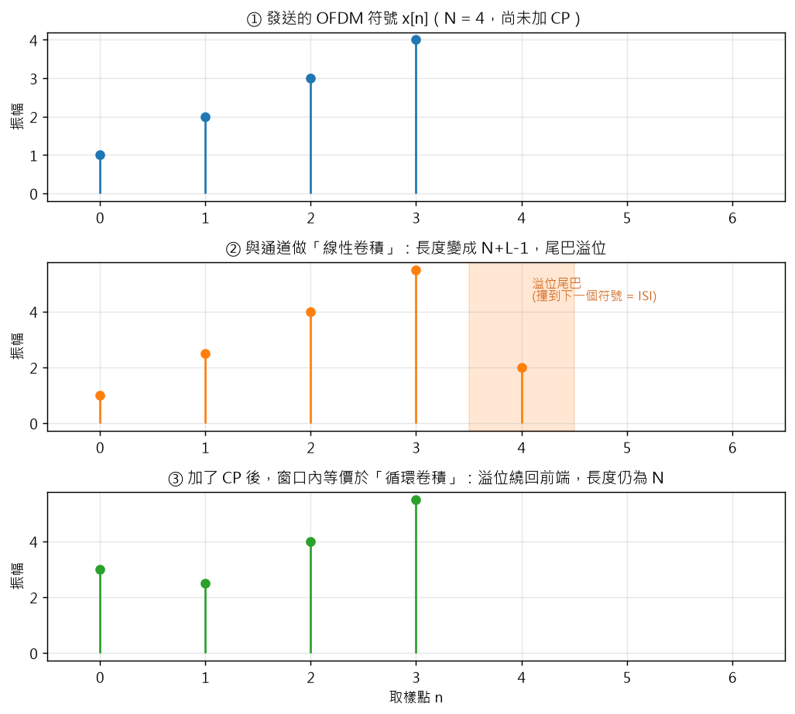

### 3. 加 CP 之後：線性卷積「看起來像」循環卷積

關鍵魔法在這裡：當我們在符號前加了長度 $\ge$ 最大延遲的 CP，再讓接收端**只取後面長度 $N$ 的窗口**，那麼「線性卷積的溢位尾巴」會剛好被 CP 補上，使窗口內看到的結果**等於原符號與通道的循環卷積 (circular convolution)**：

$$y[n] = x[n] \;\circledast\; h[n], \quad n = 0, 1, \dots, N-1$$

（$\circledast$ 表示循環卷積：索引超過 $N$ 的部分會「繞回」前端，這正是 CP 做的事。）

上圖的三個步驟就是這件事：① 原始符號 → ② 線性卷積讓尾巴溢位（撞到下一個符號）→ ③ 加 CP 後，溢位被繞回前端，變成循環卷積、長度仍為 $N$。

### 4. 循環卷積的頻域魔法：$Y[k] = H[k]\,X[k]$

循環卷積有一個 DFT 最愛的性質——**時域循環卷積，等於頻域相乘**：

$$\text{DFT}\{x[n] \circledast h[n]\} = X[k]\cdot H[k]$$

於是接收端做完 FFT 後，第 $k$ 個子載波上只會被乘上一個複數 $H[k]$：

$$Y[k] = H[k]\,X[k] + \text{雜訊}$$

這就是**單抽頭等化**的嚴格由來：只要除以 $H[k]$ 就好，

$$\hat{X}[k] = \frac{Y[k]}{H[k]}$$

不需要任何複雜的時域濾波器。可以說——

> **CP 的真正任務，不是「填時間」，而是「把線性卷積變成循環卷積」，讓頻域只剩一個乾乾淨淨的乘法。**

### 5. 為什麼「循環卷積」一定要配「正交子載波」？

因為 $Y[k] = H[k]X[k]$ 這條式子，是建立在「DFT 能把訊號乾淨地分到各子載波」之上；而這件事又依賴子載波正交。換句話說：

- **正交性**：保證子載波在頻域互不干擾（沒有 ICI）。
- **CP + 循環卷積**：保證通道在每個子載波上「只是一個複數 $H[k]$」（可以一個除法補償）。

兩者合起來，才讓 OFDM 的接收端可以又便宜又準。

---

## 快速傅立葉轉換 (FFT)：讓 DFT 從「算不動」變成「瞬間完成」

到這裡，數學上我們已經有了完整的工具：

- 發射端用 **IDFT** 把 $N$ 個子載波的資料合成時域波形
- 接收端用 **DFT** 把時域取樣還原成 $N$ 個子載波的資料

但真實系統碰上一個很現實的問題：**太慢**。

### DFT 到底有多慢？

直接照定義算 DFT，需要拿 $N$ 個頻率音叉，每個都跟 $N$ 個取樣點乘一遍：

$$\text{乘法次數} \approx N \times N = N^2$$

以 Wi-Fi / 4G 常見的 $N = 2048$ 為例：

| $N$（子載波數） | DFT 乘法次數 ($N^2$) | 若每秒 10 萬個符號 |
|---:|---:|---:|
| 64 | 4,096 | 4 億次/秒 |
| 1,024 | 1,048,576 | 1,048 億次/秒 |
| 2,048 | 4,194,304 | 4,194 億次/秒 |

這個數量級，別說手機晶片，連桌上型電腦都很難即時處理。**如果沒有更快的演算法，OFDM 根本不可能商用化。**

### FFT 的核心想法：不要重複算一樣的東西

DFT 的定義式裡藏著大量「重複計算」。例如 $N = 8$ 時，第 0、2、4、6 號音叉的某些旋轉點其實是同一個值，卻被重複乘了好幾次。**FFT (Fast Fourier Transform) 就是把這些重複的部分合併起來，用「分而治之」一次算完。**

最經典的 Cooley-Tukey 演算法，作法只有三步：

1. 把 $N$ 個取樣點**依照奇數、偶數拆成兩半**
2. 分別對這兩半做「較小規模的 DFT」
3. 利用對稱性，把兩半的結果組合起來

因為每次拆半，問題規模就減半，遞迴下去只需要 $\log_2 N$ 層：

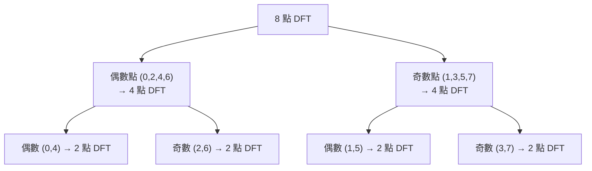

每一層約做 $N/2$ 次乘法，共 $\log_2 N$ 層 $\Rightarrow$ 總計 $\frac{N}{2}\log_2 N$ 次。

### 2-Point FFT：蝶形運算 (Butterfly)

FFT 的最小單位是「2 點 DFT」。對兩個點 $x[0], x[1]$，2 點 DFT 只有加減法：

$$X[0] = x[0] + x[1], \qquad X[1] = x[0] - x[1]$$

把它畫成訊號流程圖，兩條線交叉像蝴蝶的翅膀，所以叫**蝶形 (butterfly)**：

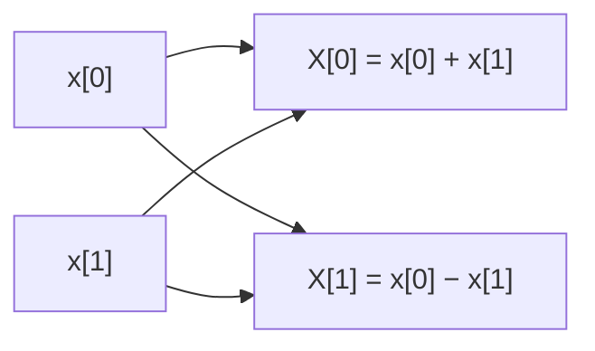

在更一般的位置，蝶形會帶一個旋轉因子（twiddle factor）$W_N^{m}$：

$$X[p] = a + W_N^{m} b, \qquad X[q] = a - W_N^{m} b$$

這就是整個 FFT 反覆堆疊的基本積木。

### N-Point FFT / IFFT（$N = 2^k$）

把 2 點蝶形一層一層往上疊，就得到 $N$ 點 FFT。因為 $N$ 是 2 的次方，每次都能「乾淨地折半」：

- **FFT**：用旋轉因子 $W_N = e^{-j\frac{2\pi}{N}}$。
- **IFFT**：把旋轉因子換成共軛 $W_N^{-1} = e^{+j\frac{2\pi}{N}}$，最後再乘 $\frac{1}{N}$。實作上通常直接**共用同一套 FFT 電路**（輸入取共軛、輸出取共軛並除以 $N$），所以硬體只要做一種蝶形單元。

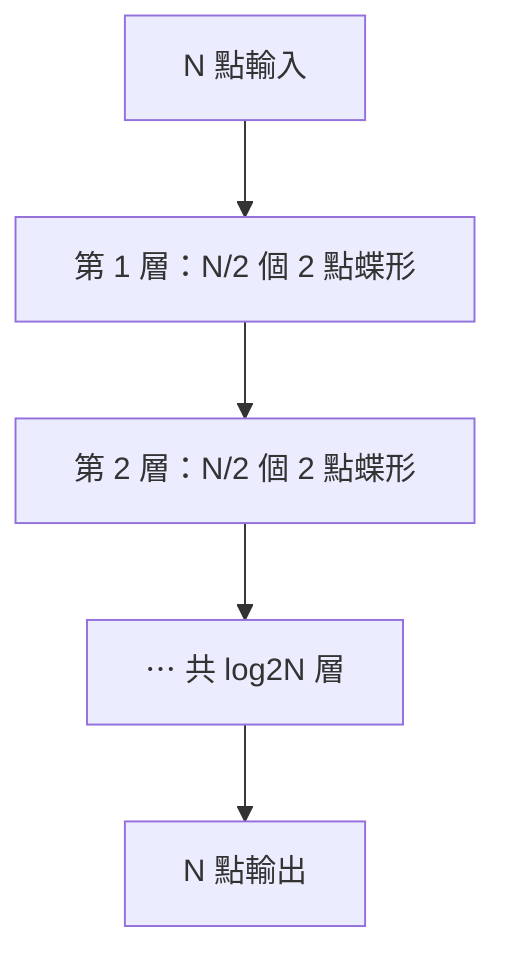

### 快了多少？

$$\text{DFT}: N^2 \quad \longrightarrow \quad \text{FFT}: \frac{N}{2}\log_2 N$$

| $N$ | DFT ($N^2$) | FFT ($\frac{N}{2}\log_2 N$) | 加速倍率 |
|---:|---:|---:|---:|
| 64 | 4,096 | 192 | 約 21 倍 |
| 1,024 | 1,048,576 | 5,120 | 約 205 倍 |
| 2,048 | 4,194,304 | 11,264 | 約 372 倍 |
| 4,096 | 16,777,216 | 24,576 | 約 682 倍 |

> **重點觀念**：FFT **不是**一種新的轉換，它算出來的結果和 DFT **一模一樣**，只是一種「比較聰明的計算方法」。所以可以把 FFT 想成「DFT 的快速演算法」，而不是另一個數學工具。

> **工程上的小約定**：發射端用的是反向的 IDFT，實作時通常也用同一套 FFT 電路（把輸入取共軛，或把正負號反過來）完成，一般統稱為 **IFFT/FFT**。

---

## OFDM 發送流程：從位元到空中的電磁波

現在把前面所有零件組起來。OFDM 發射端的工作，可以拆成六個步驟：

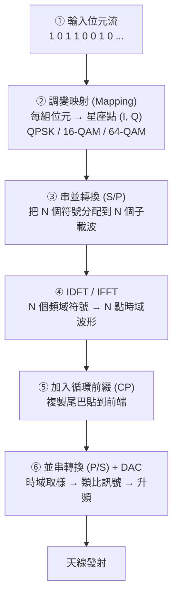

### 發送端逐步拆解

**① 輸入位元流**
上層協定送來的一串 0 與 1。

**② 調變映射 (Mapping)**
把位元分組，對應到星座圖上的點。例如 16-QAM 每 4 個位元一組，映射成一個複數 $(I, Q)$。

**③ 串並轉換 (Serial-to-Parallel, S/P)**
這是 OFDM 的關鍵一步：把原本「一個接一個排隊」的符號，**同時分配到 $N$ 個子載波上**。

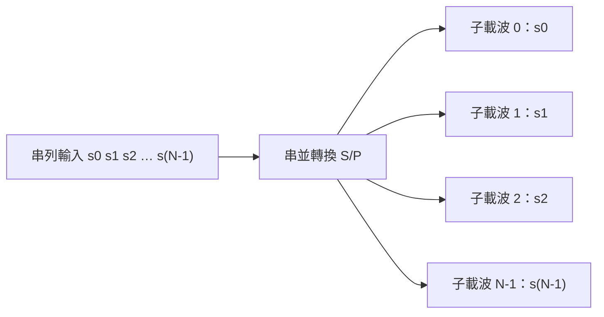

原本一個符號要佔用整條頻寬、時間很短；現在 $N$ 個符號並排，每個只佔 $1/N$ 的頻寬，但時間變成 $N$ 倍長。**總傳輸率不變，但每個子載波上的符號變「慢」了，這正是它能抵抗多路徑的關鍵。**

**④ IDFT / IFFT**
把這 $N$ 個頻域符號，轉換成一段時域波形。數學上，IDFT 做的事就是：

$$x[n] = \frac{1}{N}\sum_{k=0}^{N-1} X[k]\, e^{j\frac{2\pi}{N}kn}$$

也就是把 $N$ 個子載波（各自乘上自己的資料 $X[k]$）疊加起來。**這一步等於「同時用 $N$ 個頻率發射」，卻只需要一次數學運算，不需要 $N$ 組振盪器。**

**⑤ 加入循環前綴 (CP)**
把時域波形的尾巴複製到前端，用來對抗多路徑延遲。

**⑥ 並串轉換 + DAC + 升頻**
把並行的時域取樣排回串列，經數位類比轉換器 (DAC) 變成類比波形，再乘上高頻載波升頻到射頻頻段，由天線發射。

### 一個具體例子（$N = 4$）

假設 4 個子載波要傳送的星座點是 $X = [\,1,\ -1,\ j,\ -j\,]$：

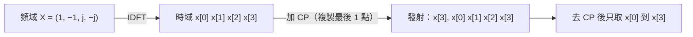

> **看懂這張圖，就懂 OFDM 的一半**：發射端從頭到尾只做了一件事——「把 $N$ 個頻域數值，用 IDFT 變成一段時域波形」。空中看起來只是一條複雜的波形，但裡面其實疊了 $N$ 個互相正交的子載波。

---

## OFDM 接收流程：把混在一起的波形拆回來

接收端基本上是發射端的「倒帶」，但方向相反：先移除 CP，再用 FFT 把子載波分開。

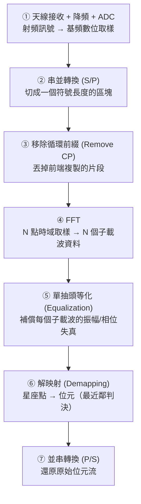

### 接收端逐步拆解

**① 接收 + 降頻 + ADC**
天線收到射頻訊號，先乘上本地載波降回基頻，再由 ADC 取樣成數位序列。

**② 串並轉換**
依照符號長度（CP + 有效資料）把連續的取樣切成一個一個區塊。

**③ 移除循環前綴**
把每個區塊前端的 CP 丟掉，只保留後面長度 $T$ 的有效資料。

> 為什麼要丟掉？因為 CP 是「複製品」，不帶新資訊；留著反而會讓 FFT 窗口對不準。

**④ FFT**
對每個區塊做 $N$ 點 FFT，得到 $N$ 個複數 $Y[k]$。由於正交性，第 $k$ 個輸出**只會包含第 $k$ 個子載波的資料**，其他子載波全部抵銷為 0。

$$Y[k] = H[k] \cdot X[k] + \text{雜訊}$$

其中 $H[k]$ 是第 $k$ 個子載波在通道上受到的振幅衰減與相位旋轉。

**⑤ 單抽頭等化 (One-tap Equalization)**
每個子載波只要除以自己的 $H[k]$，就能還原出原本的 $X[k]$：

$$\hat{X}[k] = \frac{Y[k]}{H[k]}$$

> **這是 OFDM 最漂亮的地方之一**：因為每個子載波頻寬很窄，通道在它上面幾乎是「平的」（等於一個複數常數），所以等化只需要「一個除法」，不需要複雜的濾波器。這叫**單抽頭等化 (single-tap equalizer)**，硬體成本極低。

**⑥ 解映射 (Demapping)**
把等化後的星座點，依照「最近鄰法則」判定它屬於哪個標準點，再反查表還原成位元。

**⑦ 並串轉換**
把 $N$ 個子載波還原出來的位元，依序排回原本的串列位元流，交給上層協定。

---

## OFDM 設計版本：v1 與 v2（4 個子通道）

同樣是「把通道切成 4 個子通道」，實作上有兩種典型設計思路（對應簡報的 OFDM Design v1 / v2）：

| 版本 | 子通道安排 | 特點 |
|---|---|---|
| **v1：並排不重疊** | 4 個子通道各自佔一段互不重疊的頻帶，通道之間仍留保護頻帶 | 概念接近傳統 FDM，實作簡單，但頻譜效率低（浪費保護頻帶） |
| **v2：正交重疊** | 4 個子載波以正交方式緊密重疊，不需要子載波間保護頻帶 | 頻譜效率高，是真正 OFDM 的做法；靠 IDFT/FFT 一次合成與分離 |

> 一句話：**v1 用「空間隔開」換取不干擾，v2 用「正交」換取不干擾**——而 v2 才是 OFDM 名稱中「Orthogonal」的由來。

---

## 端到端全貌：把所有零件接起來

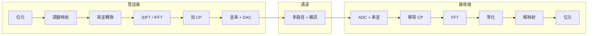

### 整章回顧：四個問題，四個答案

| 問題 | 傳統做法 | OFDM 的做法 | 關鍵原理 |
|---|---|---|---|
| 相鄰通道會互相干擾 | 留保護頻帶，浪費頻寬 | 子載波正交重疊，**不需要子載波間的保護頻帶** | 正交性 (Orthogonality) |
| 多路徑造成符號干擾 | 留空白保護時間（只擋 ISI） | 加**循環前綴 (CP)**，同時擋 ISI 與 ICI | 波形循環延伸 |
| 多路徑讓通道補償變複雜 | 需要複雜的時域等化濾波器 | **CP 把線性卷積變成循環卷積**，等化只剩一個除法 | 循環卷積 + 頻域相乘 |
| $N$ 個子載波硬體太貴、DFT 太慢 | 每路一組振盪器 / 直接算 DFT | **一組 IFFT/FFT** 全部搞定 | FFT 分治演算法 |

### 容易混淆的名詞

| 名詞 | 位置 | 作用 | 一句話記憶 |
|---|---|---|---|
| **保護頻帶 (Guard Band)** | 頻域 | 避免相鄰「通道」干擾 | 頻率上的隔離牆 |
| **保護時間 (Guard Time)** | 時域 | 避免相鄰「符號」干擾 (ISI) | 時間上的緩衝區 |
| **循環前綴 (CP)** | 時域 | 保護時間的實作方式，額外維持正交性 (抗 ICI) | 複製尾巴貼到前面 |
| **循環卷積 (Circular Convolution)** | 時域↔頻域 | CP 讓通道的線性卷積等效成循環卷積，使頻域只剩相乘 | 溢位繞回前面 |

---

## ❓ 初學者常見疑問與思維誤區 (Q&A)

??? question "Q1: CP 只是把尾巴複製一份，這樣不是重複傳送資料、浪費頻寬嗎？"
    **解答**：
    確實會浪費一點「時間」，但**不會浪費頻寬**。
    - 複製的片段不帶新資訊，所以有效資料率會下降（例如 CP 佔了總長度的 $1/8$，效率就剩下 $7/8$）。
    - 但它沒有產生新的頻率成分，子載波間距不變，因此**不佔用額外的頻譜**。
    - 相較之下，保護頻帶是直接把一整段頻率空下來、完全不能用，浪費得更徹底。所以 OFDM 選擇用 CP 換掉保護頻帶，整體頻譜效率反而更高。

??? question "Q2: 既然 FFT 和 DFT 結果一樣，為什麼課本不直接叫它 DFT？"
    **解答**：
    因為兩者的「計算成本」天差地遠。
    - **DFT** 是數學定義，直接照定義算需要 $N^2$ 次運算。
    - **FFT** 是 DFT 的一種快速演算法，利用對稱性與分治，把複雜度降到 $\frac{N}{2}\log_2 N$。

    對 $N = 2048$ 而言，兩者相差約 **372 倍**。沒有 FFT，OFDM 的即時運算根本不可能實現。所以工程上講「用 FFT 做 OFDM」，強調的是「用得起」這件事。

??? question "Q3: 接收端要怎麼知道每個子載波被通道衰減了多少（$H[k]$），才能做等化？"
    **解答**：
    實務上會發送**已知的導頻訊號 (Pilot)**。
    - 發射端在特定子載波上，插入接收端早就知道的固定符號。
    - 接收端收到後，拿「實測值 ÷ 已知值」就能估出該子載波的 $H[k]$。
    - 再依照通道的連續性，內插出其他子載波的 $H[k]$。

    這也是為什麼 Wi-Fi 與 4G/5G 的訊框裡，總會夾雜一些看起來「不是資料」的固定圖樣——它們就是讓接收端校正通道用的導頻。

---

## 本章精華總結表

| 主題 | 核心概念 | 關鍵數學 / 機制 | 解決的問題 |
|---|---|---|---|
| **保護頻帶** | 相鄰通道間留空白 | 頻譜隔離 | 相鄰通道干擾 (ACI) |
| **保護時間** | 符號間留緩衝 | $T_g \ge \tau_{\max}$ | 符號間干擾 (ISI) |
| **循環前綴 (CP)** | 複製符號尾巴到前端 | 維持窗口內波形循環，且讓線性卷積 → 循環卷積 | ISI + ICI + 單抽頭等化 |
| **DFT** | 用 $N$ 個正交音叉檢測頻率 | $X[k]=\sum x[n]W_N^{kn}$ | 時域 → 頻域 |
| **IDFT** | 把 $N$ 個頻率成分疊回波形 | $x[n]=\frac{1}{N}\sum X[k]W_N^{-kn}$ | 頻域 → 時域 |
| **DFT 矩陣** | 把 DFT 寫成 $N\times N$ 矩陣乘法 | $\mathbf{X}=F_N\mathbf{x},\ (F_N)_{kn}=W_N^{kn}$ | 用矩陣一次算完 |
| **正交性** | 不同頻率內積為 0 | $\frac{1}{N}\sum W_N^{(k_2-k_1)n}=\delta[k_1-k_2]$ | 子載波互不干擾 |
| **OFDM 頻譜** | 子載波為 sinc、波峰對準彼此零點 | $S_k(f)=\operatorname{sinc}(f-k/T)$ | 正交重疊仍不干擾 |
| **循環卷積** | 時域繞回＝頻域相乘 | $\text{DFT}\{x\circledast h\}=X[k]H[k]$ | 等化只需一個除法 |
| **FFT** | DFT 的分治快速演算法 | $N^2 \to \frac{N}{2}\log_2 N$（2 點蝶形堆疊） | DFT 運算太慢 |
| **OFDM 發送** | 位元 → 映射 → S/P → IFFT → CP | 一次合成 $N$ 個子載波 | 用單一電路發射多載波 |
| **OFDM 接收** | 去 CP → FFT → 等化 → 解映射 | 單抽頭等化 $\hat{X}[k]=Y[k]/H[k]$ | 乾淨分離並還原資料 |

---

## 總結：這條路走完了

走到這裡，你已經把實體層的完整脈絡走過一遍：

$$\text{正弦波} \;\to\; \text{方波與傅立葉} \;\to\; \text{頻寬} \;\to\; \text{調變 (ASK/PSK/QAM)} \;\to\; \text{OFDM (CP + FFT)}$$

從「一個頻率要怎麼描述」，到「怎麼把位元塞進電磁波」，再到「怎麼在惡劣的多路徑環境中，用數千個正交子載波高速又穩定地傳輸」——這條路徑，正是 Wi-Fi、4G LTE、5G NR 之所以能運作的底層邏輯。

> **最後帶走一句話**：
> OFDM 的精髓不是某個複雜公式，而是三個很樸素的念頭——
> **用正交性省下頻寬、用循環前綴換取時間、用 FFT 把數學變成能跑的電路。**

如果想重新梳理整體架構，可以回到 [實體層全景導覽](index.md)。
